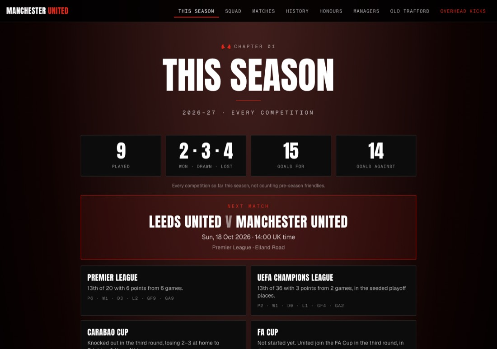
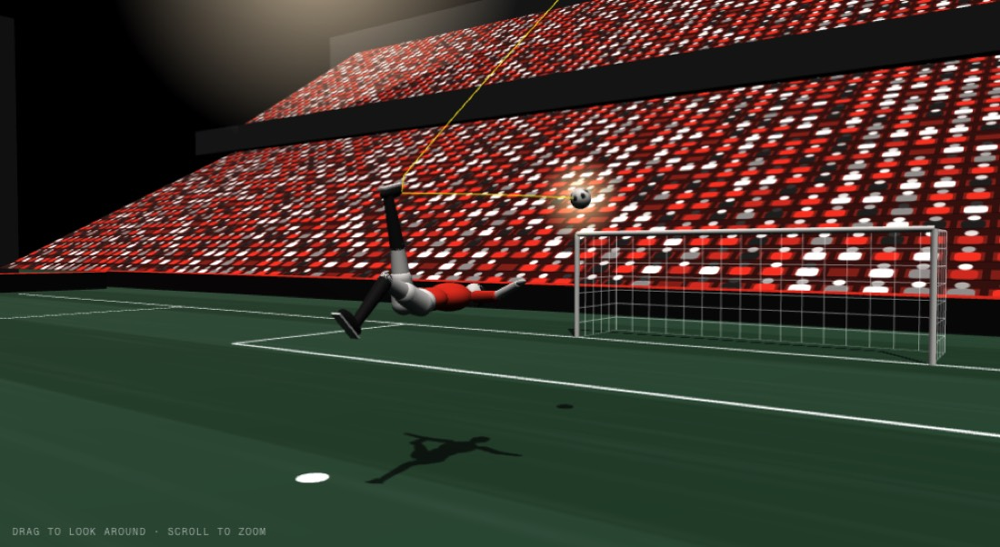

# Manchester United: an unofficial fan site

A fan-made website about Manchester United, in the club's red, black and white. It opens with a 3D night flight over Manchester that lands at Old Trafford, then lets you scroll through the chapters.

**Live site: https://ethankaufman.github.io/ManUtd-Site/**



## What is on it

* **Intro**: a scroll-driven 3D flight (three.js) over a stylised night-time Manchester that spirals down into Old Trafford.
* **Famous victories**: a slideshow of seven free-licensed photos, each with the match, date, result and photo credit.
* **01 This Season**: every competition United play in (Premier League, Champions League, Carabao Cup, FA Cup and the rest), with tables, results with scorers, fixtures, the next match and player stats. Refreshed automatically twice a day.
* **02 The Squad**: the first team by position, and a page for every player with their season numbers and every match they played.
* **08 Overhead Kicks**: an interactive 3D reconstruction of Wayne Rooney's overhead kick against Manchester City (12 February 2011), with the story of the match and its sources.
* Still to come: Every Match, History, Honours, Managers and Old Trafford.



## How it is built

Next.js (App Router) exported as plain files, TypeScript, Tailwind CSS, three.js, and a local SQLite database (Drizzle ORM) that is read **while the site is built**, so visitors never touch a database. It is hosted free on GitHub Pages.

* `scripts/update_season.py` fetches United's season from ESPN's public soccer service (an unofficial source), checks it, and saves `data/season/<season>.json`.
* `npm run db:seed` loads that file into the database, and the pages are built from it.
* `.github/workflows/update-season.yml` runs the script twice a day and republishes the site when something changed. `.github/workflows/deploy.yml` builds and publishes the site on every push.

## Run it on your computer

```bash
npm install
npm run db:migrate && npm run db:seed   # create and fill the local database
npm run dev                              # http://localhost:3000
```

`npm run build` makes the static site in `out/`. `python3 scripts/update_season.py` refreshes the season data.

## Credits and notes

* This is an **unofficial** fan project. It is not affiliated with, or endorsed by, Manchester United Football Club. Club names and marks belong to their owners, and no club crest is used.
* Match data: ESPN's public soccer service. Match and goal facts for the Overhead Kicks page come from the sources listed on that page.
* Slideshow photos are from Wikimedia Commons under free licences; each photo's author, licence and link are shown under it (and in `src/lib/slides.ts`).
  Photographers: Seán Murray (CC BY-SA 2.0), Michael Cairns (CC BY 2.0), nathan17 (CC BY 2.0), peatc (CC BY-SA 2.0), HonorTheKing (CC BY-SA 4.0).
* The 3D player and the stadium are drawn from simple shapes; the movement is an illustration, not tracking data.
