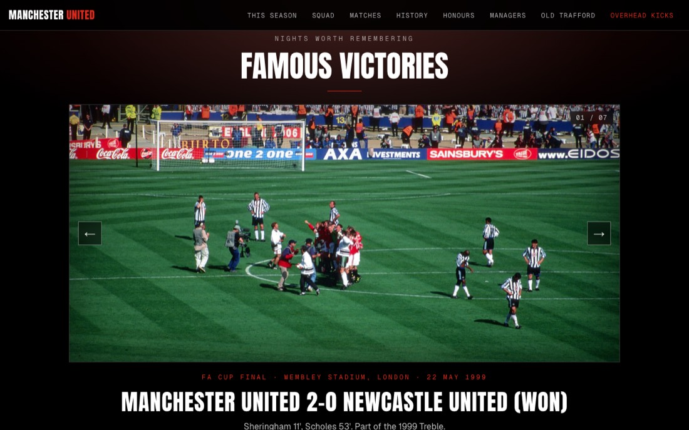

# Manchester United: an unofficial fan site

A fan-made website about Manchester United, in the club's red, black and white. It opens with a 3D night flight over Manchester that lands at Old Trafford, then lets you scroll through the chapters.

**Live site: https://ethankaufman.github.io/ManUtd-Site/**


## What is on it

* **Intro**: a scroll-driven 3D flight (three.js) over a stylised night-time Manchester that spirals down into Old Trafford.
* **Every Match**: all 35 seasons from 1992–93 (2,210 matches, every competition) with a season dropdown, competition filters and an expandable row per match; line-ups, cards and goals where the sources have them.
* **The History**: a timeline, the season-by-season record from 1886–87, every final with its date and venue, every competition, and the captains.
* **Honours & Awards**: every trophy (all time or since 1992) with a free-licensed picture, every win with its date and venue, and the individual awards.
* **The Managers**: all 30 people who have managed the club since 1889 (secretary-managers, managers, caretakers and interims) with photos, records and trophies; the current manager's record updates automatically.
* **Old Trafford**: the stadium's history, the grounds before it, the planned new 100,000-seat stadium (every statement marked official or reported), and the Carrington training ground.
* **Famous victories**: a slideshow of seven free-licensed photos, each with the match, date, result and photo credit.


* **01 This Season**: every competition United play in, with tables, results with scorers, fixtures, the next match and player stats. Refreshed automatically twice a day.
* **02 The Squad**: the first team by position, and a page for every player with their season numbers and every match they played.
* **08 The Legends**: twenty of the club's greats, each with a portrait, their story, how long they stayed and every trophy they won at United. Wayne Rooney's page includes the 3D overhead kick against Manchester City.
* **On this day**: pick any date (the home page shows today's) and see every match United played on it since 1992, every earlier cup final, and the dated moments from the club's history.
* **Head to head**: pick any club United have played since 1992 and see the record, biggest win and defeat, top scorers against them and every meeting.
* **Search**: a search box in the menu (or press `/`) finds players, legends, managers, seasons, clubs, finals and more, and opens the right page or tab.


## How it is built

Next.js (App Router) exported as plain files, TypeScript, Tailwind CSS, three.js, and a local SQLite database (Drizzle ORM) that is read **while the site is built**, so visitors never touch a database. It is hosted free on GitHub Pages.

* `scripts/update_season.py` fetches United's season from ESPN's public soccer service (an unofficial source), checks it, and saves `data/season/<season>.json`.
* `npm run db:seed` loads that file into the database, and the pages are built from it.
* `.github/workflows/update-season.yml` runs the script twice a day and republishes the site when something changed. `.github/workflows/deploy.yml` builds and publishes the site on every push.

## Run it on your computer

```bash
npm install
npm run db:migrate && npm run db:seed   # create and fill the local database
npm run dev                              # http://localhost:3000
```

`npm run build` makes the static site in `out/`. `python3 scripts/update_season.py` refreshes the season data.

## Credits and notes

* This is an **unofficial** fan project. It is not affiliated with, or endorsed by, Manchester United Football Club. Club names and marks belong to their owners, and no club crest is used.
* Match data: ESPN's public soccer service (current season and 2001–02 onward), checked against Wikipedia and the Premier League's official results; 1992–2001 from Wikipedia. Match and goal facts for the overhead kick on Wayne Rooney's page come from the sources listed there.
* Trophy photos (`public/trophies/`) are free-licensed pictures from Wikimedia Commons chosen by hand and downloaded with `scripts/fetch_trophy_photos.py`; the credit for each is shown on its card and kept in `src/lib/trophy-photos.json`.
* Manager photos (`public/managers/`) are free-licensed Wikimedia Commons pictures (`scripts/fetch_manager_photos.py`); Matt Busby and Jimmy Murphy are shown by their statues, and every photo is captioned with what it shows and credited on the page.
* Stadium photos (`public/stadium/`) are free-licensed Wikimedia Commons pictures (`scripts/fetch_stadium_photos.py`), credited under each picture. The club's and Foster + Partners' images of the new stadium design are not free to use, so they are described and linked, not shown.
* Legend portraits (`public/legends/`) are free-licensed Wikimedia Commons pictures (`scripts/apply_legend_photos.py`); for the older legends the only free pictures are statues or later portraits, and each page says what its photo shows. Stories are written from Wikipedia's articles and trophies are checked against the site's own finals and titles.
* Squad photos (`public/players/`) are free-licensed pictures from Wikimedia Commons (CC BY, CC BY-SA or CC0), found with `scripts/fetch_player_photos.py`;
  each player's page shows the photographer, licence and a link, and the full list is in `src/lib/player-photos.json`. Players without a free photo have none.
* Slideshow photos are from Wikimedia Commons under free licences; each photo's author, licence and link are shown under it (and in `src/lib/slides.ts`).
  Photographers: Seán Murray (CC BY-SA 2.0), Michael Cairns (CC BY 2.0), nathan17 (CC BY 2.0), peatc (CC BY-SA 2.0), HonorTheKing (CC BY-SA 4.0).
* The 3D player and the stadium are drawn from simple shapes; the movement is an illustration, not tracking data.
